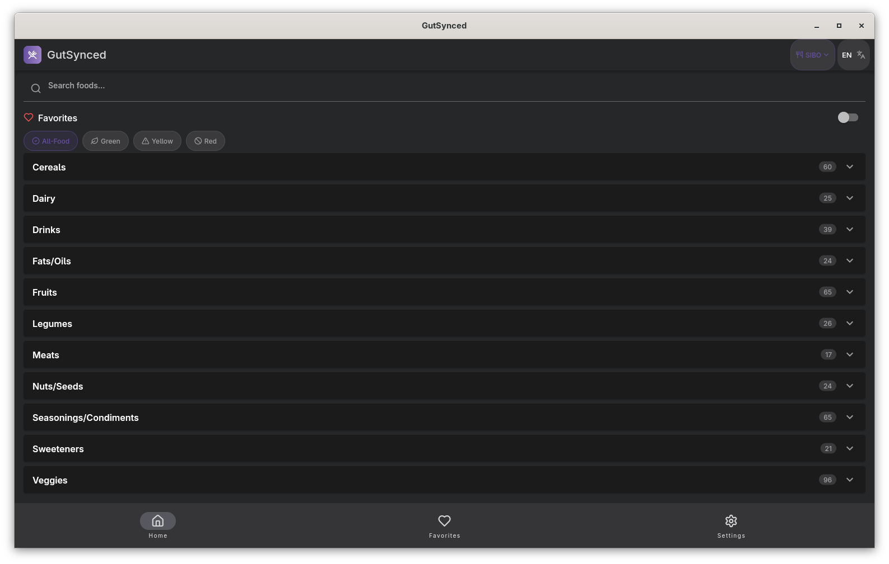

# GutSynced

GutSynced is a Flutter app for checking foods against four gut-health diets: **SIBO**, **SSRD**, **bile reflux**, and **6FED-LR**. Every food is marked allowed, caution, or avoid, so a lookup gives a clear answer.

## Features

- Four diet profiles: SIBO, SSRD, Bile Reflux, and 6FED-LR.
- Traffic-light food status: green for allowed, yellow for caution, red for avoid.
- Category browsing and food search.
- Favorites for quick access.
- English, Arabic, Spanish, French, and Hindi.
- Light and dark themes.
- Runs on Android, iOS, web, Windows, macOS, and Linux.

## Screenshot



## Download

- Web app: https://gutsynced-app.web.app
- Android APK: [latest release](https://github.com/shipschematic/gut-synced-app/releases)

## Build from source

Requires Flutter 3.5 or newer.

```bash
git clone https://github.com/shipschematic/gut-synced-app.git
cd gut-synced-app
flutter pub get
flutter run
```

Build a specific platform:

```bash
flutter build apk --release      # Android
flutter build web                # Web
flutter build windows            # Windows
flutter build macos              # macOS
flutter build linux              # Linux
flutter build ios --release      # iOS, requires macOS and Xcode
```

## Project layout

```text
lib/
├── app/          controllers, models, and food repository
├── helpers/      services, theme, storage, and localization
├── route/        GoRouter routes
├── view/         screens and widgets
└── main.dart
assets/
├── data/         diet JSON files and env.json
├── images/       images and icons
└── lang/         translations
```

## Data

Food databases live in `assets/data/`:

| File | Diet |
|---|---|
| `food_data.json` | SIBO / low FODMAP |
| `ssrd_data.json` | Starch- and sucrose-reduced |
| `bile_data.json` | Bile reflux |
| `6fedlr_data.json` | 6-food elimination and low residue |

Each entry has a name, category, and status. `env.json` holds optional Supabase credentials. Leave it empty to run fully offline.

## License

[MIT](LICENSE)
